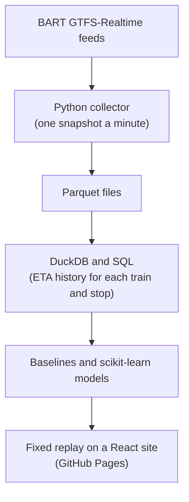

# BART Reliability Lab

BART publishes an estimated arrival time (ETA) for each train and keeps updating it as
the train gets closer. This project measures how much those estimates change before a
train reaches a station, and tests whether a model can predict the remaining change
better than simple baselines.

Live demo: <https://millerroberts180.github.io/bart-reliability/>

The demo is a fixed historical replay of BART data as of Tuesday, October 20, 2026 at
10:00 AM Pacific. It is not live, and nothing on it updates. The model predicts how much
BART will still revise its own published ETA. It does not predict when a train
physically arrives.

Results:

- The collector completed all 15,088 one-minute polls from October 10 to 20, 2026, and
  all 30,180 saved snapshots passed validation
  ([data checkpoint](docs/data_checkpoint_2026-10-20.md)).
- On the held-out test day, Monday, October 19, the selected model's mean absolute error
  was 19.68 seconds. A historical-median baseline scored 20.94 s, and assuming the ETA
  will not change scored 41.00 s ([evaluation](docs/eta_model_evaluation_2026-10-20.md)).
- For revisions larger than 60 seconds, the model's PR-AUC was 0.603, against 0.530 for
  the baseline, and its Brier score was 0.100, against 0.111.
- The model beat the baseline in all 2,000 trip-level bootstrap resamples, with a 95%
  interval of −1.39 to −1.12 s for the error difference. The gain is small, though: about
  1.25 s, or 6% of the baseline's error, measured on one Monday.


## How it works



A Python collector saved BART's trip-update and alert feeds once a minute on a small
cloud server. The snapshots are converted to Parquet and loaded into DuckDB. There, SQL
rebuilds each train's ETA history at each stop and finds BART's final stable estimate
for it. That final estimate is the reference point: a revision is how far the ETA still
moved between a snapshot and the final estimate.

Models are trained and evaluated offline. For the public site, a small FastAPI app that
runs only locally answered every request the site can make as of 10:00 AM on October 20,
and its answers were saved as JSON files. GitHub Pages serves those files with a
React/Vite interface for exploring the replay, so the site has no server or database.

The linked documents below give the details of each step.

## Evaluation

Each example is one train at one stop, taken when BART's ETA said the train was about 5,
10 or 15 minutes away. The model predicts how many seconds the ETA will still move before
BART's final stable estimate, and, separately, the probability that it moves by more than
60 seconds.

- The data is split by date, in order. The models were trained on October 10 to 15,
  chosen on October 16 to 18, and tested once on October 19. The split, the metrics and
  the rules for reading the result were committed before any model was fitted
  ([modeling plan](docs/modeling_plan.md#preregistered-evaluation-2026-10-20-checkpoint)).
- There are two baselines. One assumes the ETA will not change. The other uses the
  median revision for the same horizon, route and stop in the training data.
- Features use only the current snapshot, earlier snapshots and the published schedule.
  SQL checks stop the run if a feature reads a later snapshot. Tests check that changing
  later estimates, or the validation and test labels, leaves the features and baselines
  unchanged.
- The candidates were linear models and scikit-learn's gradient-boosted trees. The trees
  did best on the validation days.

Results on the test day (33,830 examples):

| | Selected model | Historical baseline | No change |
|---|---|---|---|
| Mean absolute error (s) | 19.68 | 20.94 | 41.00 |
| Brier score, revision over 60 s | 0.100 | 0.111 | 0.174 |
| PR-AUC, revision over 60 s | 0.603 | 0.530 | 0.174 |

The 95% interval in the results above comes from a bootstrap that resamples whole
trips, because stops on the same trip are related. The model also gives an 80% range for each revision, and on the
test day that range covered 83% of examples
([model serving](docs/model_serving.md#the-2026-10-20-bundle)).

The site also shows how BART's ETA for the selected train changed over the hour before
the replay time:


## Limitations

- The project measures revisions to BART's published ETAs,
  not physical arrivals. BART publishes no independent arrival data to check against
  ([511 feed review](docs/511_arrival_feasibility.md)).
- The public site shows one recorded moment. It is not a live service.
- The final evaluation covers one Monday. The improvement is consistent
  across resamples but modest, and a single day can't show how the model would do on
  other weekdays, weekends or disrupted days.
- The data covers about ten days in one season. Collection has
  ended, so there is no newer data.
- Only part of the service is modelled. At the replay moment, 79 of
  the 1,057 trains on the site had a forecast. The rest show BART's ETA with the reason
  there is no forecast.

## Tools

- Primary analysis: Python, DuckDB/SQL and scikit-learn
- Data formats: GTFS-Realtime, Parquet and DuckDB
- Presentation: React, TypeScript and Vite
- Testing and deployment: pytest, Vitest, GitHub Actions and GitHub Pages

## Testing

The Python tests (474, with pytest) cover the collector, the Parquet conversion, the
warehouse queries, the leakage and split rules, the models and the replay export. The
website has 226 Vitest tests. GitHub Actions runs both on every push, along with a check
of the published replay files. GitHub Pages deploys only from `main`.

## Running it locally

This needs Python 3.11 or later and Node 24.

```bash
python3 -m venv .venv
.venv/bin/pip install -e '.[dev,model,serve]'
.venv/bin/pytest
.venv/bin/bart-static-replay check    # checks the published replay files

cd web
npm ci
npm run dev:static                    # the replay, as on GitHub Pages: http://localhost:5173/
npm run test
```

The pipeline steps need the raw data under `data/`, which is not in the repository:

```bash
.venv/bin/bart-collect --once         # one poll of BART's live feeds
.venv/bin/bart-transform              # raw snapshots -> Parquet
.venv/bin/bart-build-warehouse        # Parquet + static schedule -> DuckDB
.venv/bin/bart-eta-model              # features, baselines, models and metrics
.venv/bin/bart-serve-local            # local replay API on 127.0.0.1:8000
.venv/bin/bart-static-replay export   # save the API's answers as JSON files
```

More commands, and the site's other data modes, are in
[website_architecture.md](docs/website_architecture.md#local-development) and
[static_replay.md](docs/static_replay.md#command).

## Repository layout

```text
src/bart_reliability/
  collector/       polling, validating and storing feed snapshots
  transform/       snapshots -> hourly Parquet
  warehouse/       DuckDB tables and SQL: schedule joins, ETA histories, alerts
  modeling/        features, splits, baselines, models and metrics
  serving/         packaging the selected models for predictions
  api/             local FastAPI replay app
  static_replay/   saving and checking the public replay files
  open511/         review of the 511 regional feed as an arrival source
config/            settings for each step
tests/             pytest tests
web/               the React site; web/public/replay/ holds the published replay
deploy/            configuration for the collection server
docs/              design notes, audits and evaluation reports
```

## Project status

Collection ended intentionally after a final backup was verified. The backup holds every
snapshot collected from 2026-10-10 08:11:07 UTC to 2026-10-20 19:39:23 UTC, before the
export cutoff of 19:40:00 UTC. It has 30,180 files, and their SHA-256 hashes match the
server's. The DigitalOcean server used for collection has since been retired, and the
public site does not depend on any server
([deployment notes](docs/deployment.md#status-retired)). Draft notes for a v1.0 release
are in [docs/release_v1.md](docs/release_v1.md).

## Documentation

| Topic | Document |
|---|---|
| The question, and why it is about ETA revisions | [PROJECT_SPEC.md](PROJECT_SPEC.md) |
| Collection: deployment, 24-hour test, final backup | [deployment.md](docs/deployment.md), [collection_validation.md](docs/collection_validation.md), [data_checkpoint_2026-10-20.md](docs/data_checkpoint_2026-10-20.md) |
| Parquet schema and DuckDB warehouse | [trip_updates_schema.md](docs/trip_updates_schema.md), [warehouse.md](docs/warehouse.md) |
| ETA revisions and the final-estimate reference | [observed_arrival_proxy.md](docs/observed_arrival_proxy.md) |
| Service alerts | [service_alerts.md](docs/service_alerts.md), [alert_annotation_review_2026-10-20.md](docs/alert_annotation_review_2026-10-20.md) |
| Modeling plan and evaluation | [modeling_plan.md](docs/modeling_plan.md), [eta_model_evaluation_2026-10-20.md](docs/eta_model_evaluation_2026-10-20.md) |
| Model packaging and the 80% range | [model_serving.md](docs/model_serving.md) |
| Local API and boarding groups | [local_api.md](docs/local_api.md), [boarding_groups.md](docs/boarding_groups.md) |
| Static replay and website | [static_replay.md](docs/static_replay.md), [website_architecture.md](docs/website_architecture.md) |
| Why the 511 feed is not an arrival source | [511_arrival_feasibility.md](docs/511_arrival_feasibility.md) |

## Data source and license

The collector, warehouse, models and public site use BART's open data: the GTFS
schedule and the GTFS-Realtime trip-update and alert feeds, published by the San Francisco
Bay Area Rapid Transit District (BART) through its
[developer program](https://www.bart.gov/about/developers) and used under the
[BART Developer License Agreement](https://www.bart.gov/schedules/developers/developer-license-agreement).
The agreement grants limited, revocable rights to use, reproduce and redistribute the
data. The replay published with the site redistributes values taken from it. BART
provides the data without warranty and may change or stop it at any time.

The public site's footer credits BART as the source of the GTFS and GTFS-Realtime data
and links to both pages.

ETA Reliability is an independent project. It is not an official BART product, and it
is not affiliated with or endorsed by BART.

The agreement does not allow BART trademarks or copyrighted materials to be used with
the data. The site and this repository therefore use no BART logo and no official
system map. Line colours are the `route_color` values in BART's GTFS feed.

## Data

Nothing under `data/` is committed, and later steps never modify raw snapshots. The only
data Git tracks is the published replay in `web/public/replay/`. It holds the reduced
answers alone: no raw feeds, warehouse rows, models or bundles
([static_replay.md](docs/static_replay.md#the-published-replay)).
